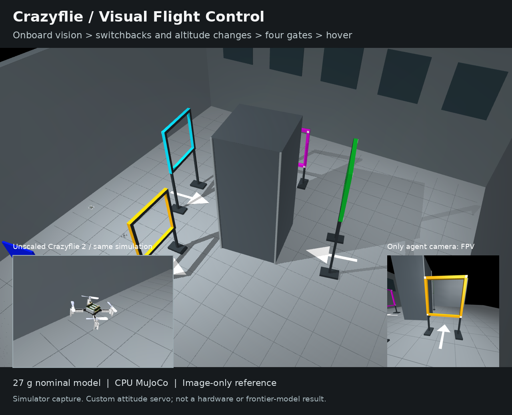
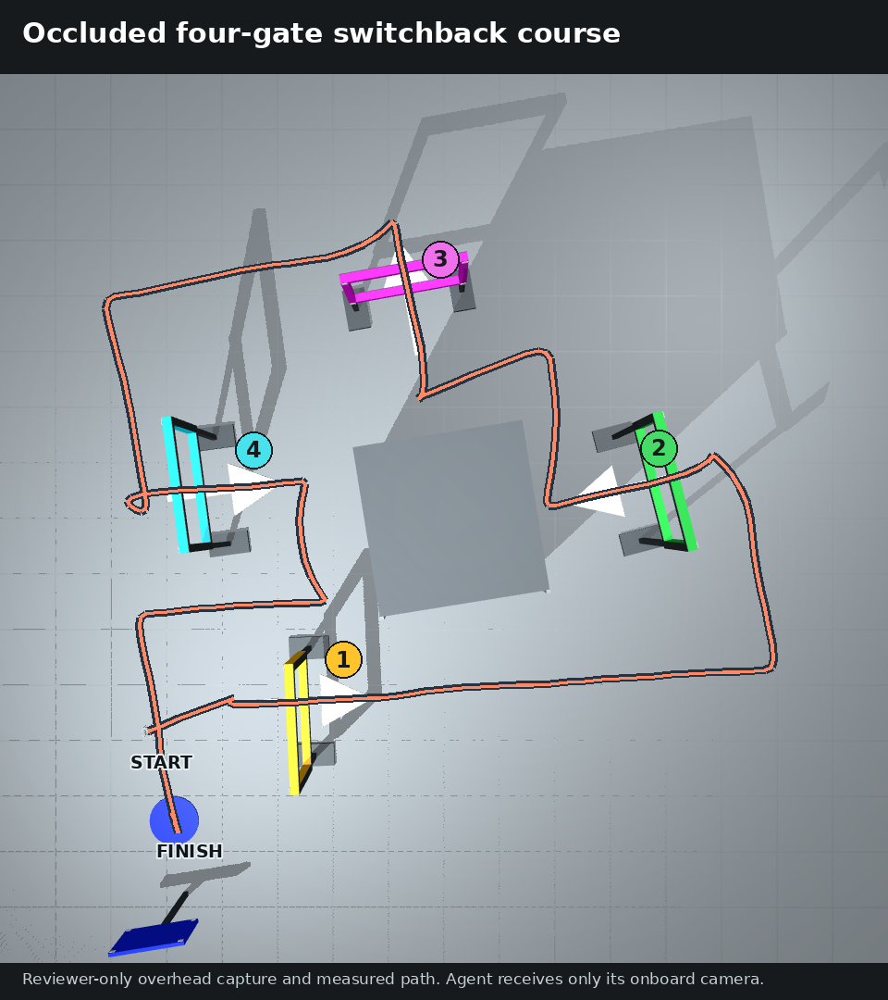

# Successful Reference Submission

> **Maintainer changes, 2026-10-29 (v8).** The task as reviewed (v7) had four problems: the probe perturbation (a
> view from 0.5-1.4 m away) zeroed honest controllers that fly short stretches from memory and contaminated stateful
> ones; the scene randomization was narrower than the gate tolerance, so a recorded flight replayed open-loop passed
> 83-99 % of fresh scenes; the verify stage had an unstated 900 s cap; four binary scenes gave a coarse score. v8:
> gates 0.7 m (crossing window 0.26 m); the whole course turned by a random multiple of 90 degrees plus up to
> 0.18 rad, gates moved by up to 0.25 m and turned by up to 0.2 rad, the start moved by up to 0.25 m and its heading
> drawn within 90 degrees (layouts too close to the cabinet are redrawn); eight scenes; probes from a viewpoint
> 3-6 cm and 1-3 degrees away, at least a quarter of them must change the action; a stated 1500 s budget of controller
> reply time (`timeouts.verify` 5400 s: up to 2,640 onboard frames at about 0.55 s each on the task's two CPUs, plus
> the full budget); the oracle searches for the first gate and uses the new marker size. Measured:
> a recorded oracle flight replayed on 128 fresh scenes completes 0 (0 of 96 with the same quarter turn); the oracle
> completed 24/24 scenes in three `ale validate` runs and 63/64 offline. The v7 notes below are historical.
>
> **Maintainer changes, 2026-10-30/31 (the onboard view).** The course now stands in the main hall of the Unity Asset
> Store pack "Warehouse - Abandoned Factory District 1.1" (ScansFactory), cleared around the flight volume (render-only
> scenery: no collision, no effect on the physics). The onboard camera is rendered by MuJoCo 3.16's Filament module on
> the CPU (Mesa lavapipe), lit by an image light distilled from an OVRTX path-traced light probe of the hall plus the
> sun, with per-class gains calibrated against OVRTX renders of the onboard view on the recorded oracle flight
> (`verify/fil_render.py`, byte-identical to `setup/runtime/fil_render.py`). The gates keep the task's colours, with
> worn-paint textures and twice the glow, so their colour cues hold under the hall's light. The scenery (meshes and
> 256 px textures), the course's textures and the two KTX maps (image light, sky) are fetched at image build from the
> benchmark's Hugging Face dataset, pinned in `image/assets.sha256`, into the root-owned `/opt/task-assets/payload/render`.
> A frame takes about 0.54 s on the task's two CPUs; the verify process peaks at about 1.3 GB (textures at 256 px, the
> heap trimmed after every scene). Measured: `ale validate` validate-aeacedc0, the oracle completed 7 of 8 fresh scenes
> (ratio 0.875, at or above `full_at` 0.85: reward 1.0), verify 22.9 min, zero collisions and aborts; the task's own tests pass.

The v7 oracle supplies `run.sh` and `policy.py`, completes the exploration scene,
and leaves its initial/final camera PNGs plus `example_interaction.json` in the
collected submission. The verifier then runs that controller on four new scenes.
The recorded demonstration itself is not a grading input.

It reconstructs metric gate poses from the single onboard camera's corner
markings, maintains a motion observer, and uses feedback for approach, crossing,
search and hover. No simulator imports or privileged runtime-state reads occur.
It has **author-supplied design priors**, including nominal switchback geometry,
safe transit waypoints and dynamics. The nominal route is registered to visual
landmarks; actual gate poses and the goal are measured from images. This is a
solvability reference, not a fair uninformed model baseline.

The image above is an actual simulator capture from development seed 101. The
large view and close-up are reviewer cameras; the inset is the real agent camera.
It is not a photorealistic rendering, an LLM run or a hardware demonstration.

Four gates require yellow > green > magenta > cyan crossings. White floor arrows
specify direction; colored entry faces have white corners and gray backs. The
course reverses entry directions, alternates low/high gates, routes around an
opaque cabinet and returns toward the starting side.
The route image overlays reviewer labels and the measured trajectory on an
overhead capture unavailable to the controller. Only the onboard inset is public.

The frozen reference completed 26 development/regression/holdout scenes with
zero collisions (41.83-46.42 simulated seconds); 20 probed scenes passed 323/432
probes. ALE calibration `validate-2f68303c` then completed four fresh private
scenes, zero collisions/aborts, 70/92 aggregate probes, reward 1.0. One scene's
11/23 probe sensitivity was below half; the task aggregates probes across scenes.
Provenance is in `../verify/anchor.json`. No earlier-version results are reused.
These checks demonstrate solvability, not frontier-model difficulty or hardware
robustness. The separate `tools/privileged_reference.py` uses true state and must
never be confused with this submitted image-only reference.

See [the reviewer guide](../tools/REVIEW.md) to reproduce the tests, generate a
video and check that forged success and reset attempts receive no credit.
